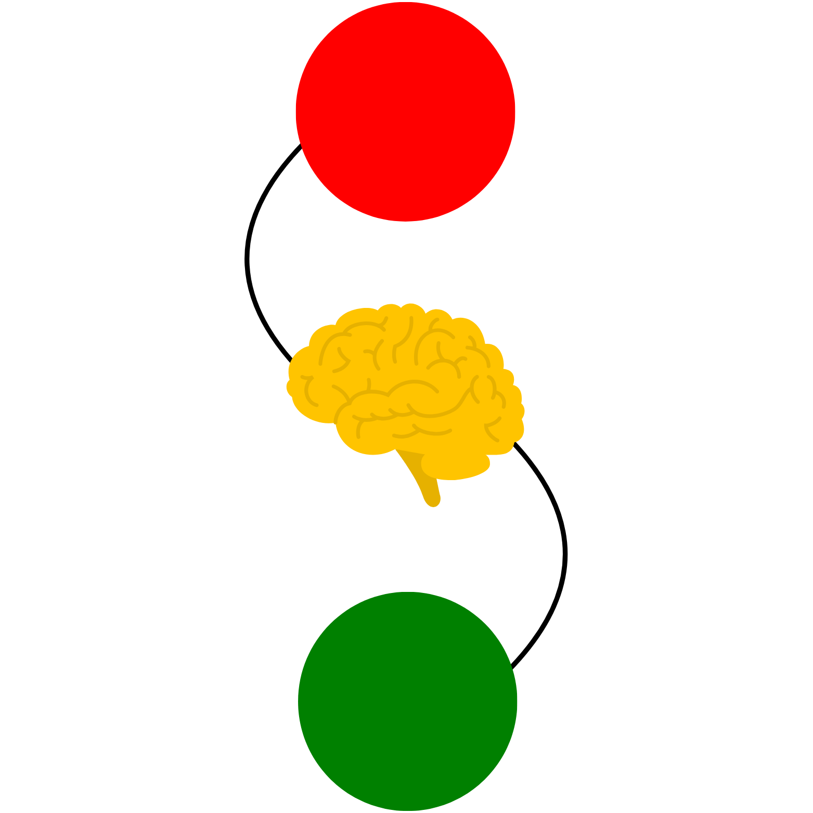
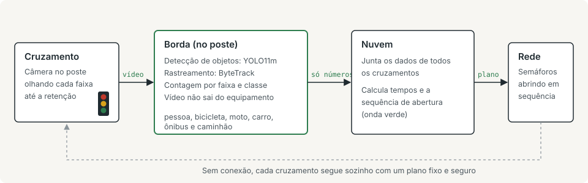

<h1 align="center">IITLS</h1>

Intelligent Integrated Traffic Light System

Finalista do Red Bull Basement 2026, entre os 5 projetos selecionados no Brasil

 

A maioria dos semáforos no Brasil funciona com tempo fixo: abre para a rua vazia e segura a rua cheia. O IITLS coloca uma câmera em cada cruzamento, conta veículos e pedestres por faixa ali mesmo, no poste, e usa esses números para fazer os semáforos de um corredor abrirem em sequência, a chamada onda verde.

O vídeo não sai do equipamento. Para a rede vão só as contagens, o que deixa a comunicação barata e protege quem passa na rua.

## O que já funciona

Detecção, rastreamento e contagem de veículos e pedestres por faixa em vídeo de trânsito.

| Etapa | Como é feito hoje |
|---|---|
| Detecção | YOLO11m treinado no BDD100K (70 mil imagens de trânsito), 20 épocas, entrada de 960 px |
| Rastreamento | ByteTrack, para que o mesmo veículo não seja contado duas vezes |
| Contagem | Linhas virtuais por sentido da via, com filtro de duplicidade |
| Ambiente | Docker com Python 3.11, PyTorch e CUDA, rodando em GPU NVIDIA |

Precisão do detector na validação do BDD100K (AP50):

| Classe | AP50 |
|---|---|
| Carro | 0,84 |
| Pessoa | 0,72 |
| Caminhão | 0,70 |
| Ônibus | 0,69 |
| Bicicleta | 0,56 |
| Moto | 0,53 |
| Média | 0,61 |

Moto e bicicleta são os pontos fracos, e moto pesa muito no trânsito brasileiro. É por isso que o próximo modelo está sendo treinado com imagens de câmeras de trânsito fixas e elevadas, o mesmo ponto de vista de um poste, em vez de câmeras de painel de carro.

## Próximos passos

1. Novo detector treinado com câmeras de trânsito, publicado no Hugging Face
2. Medição de fila por faixa dentro de uma distância fixa da faixa de retenção
3. Validação em vídeo de cruzamentos brasileiros, de dia, de noite e com chuva
4. Simulações para definir posição da câmera e desempenho no NVIDIA Jetson Orin Nano
5. Coordenação dos semáforos validada em simulação, sempre com regras fixas de segurança
6. Testes em cruzamentos reais em modo observação, antes de atuar em qualquer semáforo

O código do sistema completo é privado.

## Contato

Prefeituras e concessionárias interessadas em uma prova de conceito: iitls.startup@gmail.com

Site: [iitls.vercel.app](https://iitls.vercel.app)

Fundadores: Matheus Germann, João Vitor Soska e Pedro Otávio Nunes

## English

IITLS puts a camera at each intersection, counts vehicles and pedestrians per lane on the device itself and uses those counts to coordinate the traffic lights along a corridor. Video never leaves the pole; only the numbers do. Today it runs YOLO11m with ByteTrack; the next detector is being trained on elevated traffic-camera footage and will be published on Hugging Face. Red Bull Basement 2026 finalist, one of 5 projects selected in Brazil.
